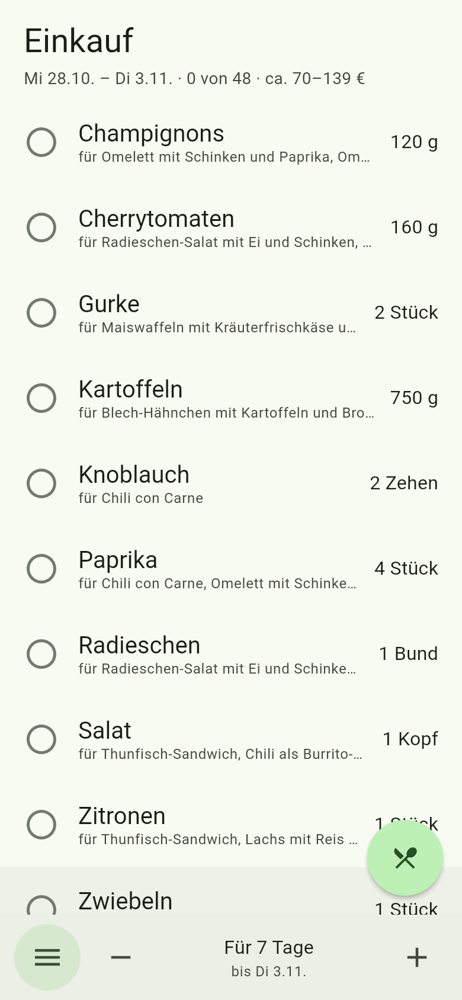
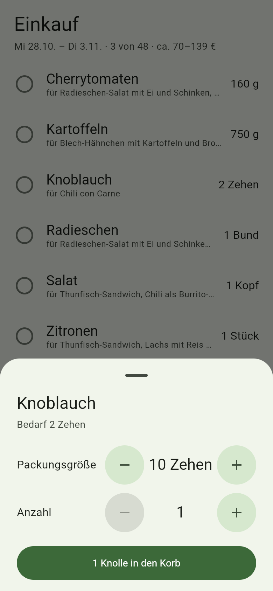
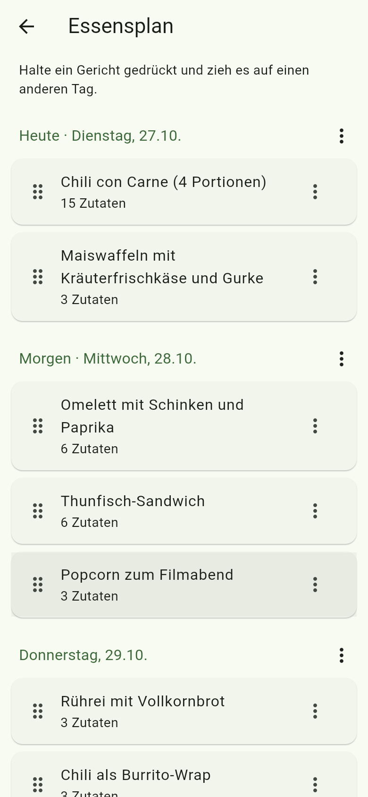

# Kaufi

Kaufi macht aus deinem Essensplan die Einkaufsliste. Die App merkt sich, was noch zu Hause ist, und lernt deinen Weg durch den Laden. Sie ist für den Moment gebaut, in dem du den Supermarkt betrittst: App auf, Liste da, mit einer Hand abhaken.

Alles bleibt auf dem Gerät. Kein Konto, keine Werbung, und die Release-App hat nicht einmal die Berechtigung, ins Internet zu gehen.

<p>
  
  
  
</p>

## So funktioniert es

1. **Plan holen.** Im Menü „Prompt für deine KI kopieren“ antippen und den Text in einen KI-Chat einfügen. Dort besprichst du, was du essen willst, und die KI antwortet mit einem Plan im [Kaufi-Format](docs/importformat.md).
2. **Importieren.** Die Antwort kopieren und „Aus der Zwischenablage einfügen“ wählen, oder die Antwort bzw. Datei über „Teilen → Kaufi“ schicken. Eine `.json`-Datei lässt sich auch direkt mit Kaufi öffnen.
3. **Einkaufen.** Kaufi zeigt, was für die nächsten Tage fehlt, aufgerundet auf übliche Packungsgrößen.

### Bedienung im Laden

| Geste | Wirkung |
| --- | --- |
| Antippen oder nach rechts wischen | In den Korb. Nochmal antippen holt es zurück. |
| Nach links wischen | „Hab ich schon“: Kaufi nimmt an, dass mindestens eine Packung zu Hause ist. |
| Lange drücken | Packungsgröße und Anzahl ändern. Die Packungsgröße merkt sich Kaufi. |
| − / + unten, oder seitlich über die Tage wischen | Für wie viele Tage du einkaufst. |
| Gerichte-Knopf gedrückt halten, in die Mitte ziehen, drehen, loslassen | Nur die Zutaten eines Gerichts zeigen. „Alle Zutaten“ im Drehrad oder Antippen des Knopfs hebt den Filter auf. |
| „Fertig“ | Einkauf abschließen. Passiert nach vier Stunden ohne Abhaken auch von selbst. |

Wischen, die direkt am Bildschirmrand beginnen, gehören der Zurück-Geste von Android und lösen in der Liste nichts aus.

### Was Kaufi im Hintergrund macht

- **Reihenfolge lernen.** Die Reihenfolge, in der du Zutaten zum ersten Mal abhakst, wird zu ihrer Reihenfolge in der Liste. Neue Zutaten landen hinter der, die du davor abgehakt hast. Was noch nie gekauft wurde, steht neben Zutaten aus derselben Abteilung.
- **Vorrat führen.** Was du kaufst, kommt in den Vorrat. Ist ein Tag vorbei, zieht Kaufi ab, was laut Plan gegessen wurde. Übrig gebliebene Eier stehen also nächste Woche nicht wieder auf der Liste. Unter „Vorrat“ kannst du korrigieren.
- **Plan anpassen.** Unter „Essensplan“ hältst du ein Gericht gedrückt und ziehst es auf einen anderen Tag, oder du schiebst ab einem Tag alles nach hinten. Die Einkaufsliste rechnet sich neu.
- **Preis schätzen.** Der Katalog hat grobe Preisspannen pro Packung, die Liste zeigt die Summe.

## Installieren

Fertige APKs gibt es unter [Releases](../../releases). Mit [Obtainium](https://github.com/ImranR98/Obtainium) kannst du dieses Repository als Quelle eintragen und bekommst Updates automatisch.

## Entwicklung

Kaufi ist eine Flutter-App (Android jetzt, iOS später aus demselben Code).

```sh
flutter pub get
flutter test              # Logik- und Widget-Tests
flutter run               # auf Gerät oder Emulator
flutter run -d chrome     # schnelle Vorschau im Browser
```

| Ordner | Inhalt |
| --- | --- |
| `lib/logic/` | Fachlogik ohne Flutter: Import, Bedarf, Vorrat, Routenlernen, KI-Prompt |
| `lib/catalog/`, `assets/catalog.json` | Zutatenkatalog mit IDs, Synonymen, Packungsgrößen, Preisen |
| `lib/ui/` | Bildschirme |
| `android/.../MainActivity.kt` | Empfang von „Teilen“ und geöffneten Dateien |
| `docs/` | Importformat und JSON-Schema |

Neue Zutaten oder Synonyme gehören in `assets/catalog.json`. Die Tests prüfen, dass IDs eindeutig sind und der Beispielplan sauber importiert.

### Releases signieren

Android installiert ein Update nur, wenn es mit demselben Schlüssel signiert ist. Einmalig einen Schlüssel erzeugen und gut aufheben:

```sh
keytool -genkey -v -keystore kaufi.jks -keyalg RSA -keysize 4096 -validity 10000 -alias kaufi
```

Dann im Repository unter *Settings → Secrets and variables → Actions* diese Secrets anlegen:

| Secret | Inhalt |
| --- | --- |
| `KAUFI_KEYSTORE_BASE64` | Ausgabe von `base64 -w0 kaufi.jks` |
| `KAUFI_KEYSTORE_PASSWORD` | Passwort des Keystores |
| `KAUFI_KEY_ALIAS` | `kaufi` |
| `KAUFI_KEY_PASSWORD` | Passwort des Schlüssels |

Ein Tag wie `v0.1.0` baut dann eine signierte APK und veröffentlicht sie als Release. Auch die Test-APKs aus der CI werden damit signiert und lassen sich als Update übereinander installieren. Ohne Secrets wird mit einem Debug-Schlüssel signiert. Lokal geht dasselbe über `android/key.properties` (`storeFile` relativ zu `android/app`, `storePassword`, `keyAlias`, `keyPassword`).

## Ideen für später

- Mehrere Läden mit eigener Reihenfolge
- Eigenes F-Droid-Repository
- Zutaten zusammenführen, wenn doch einmal zwei Namen dasselbe meinen
- Katalog aus der Zutaten-Taxonomie von Open Food Facts erweitern
- Import direkt aus einem KI-Chat über eine Integration
